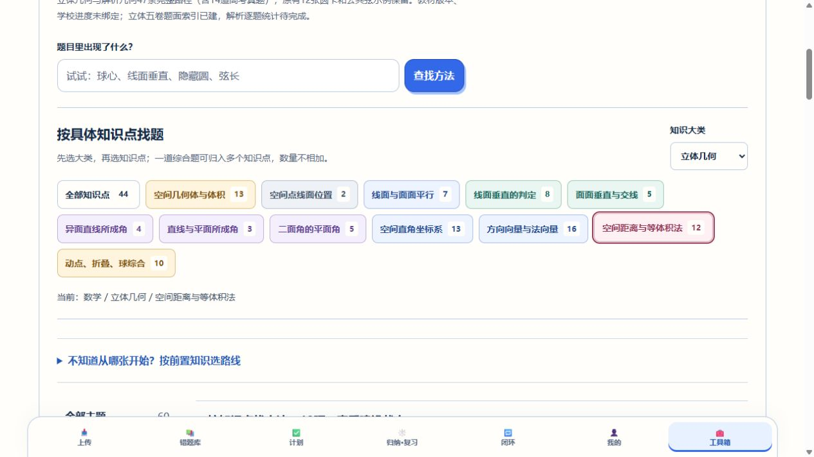
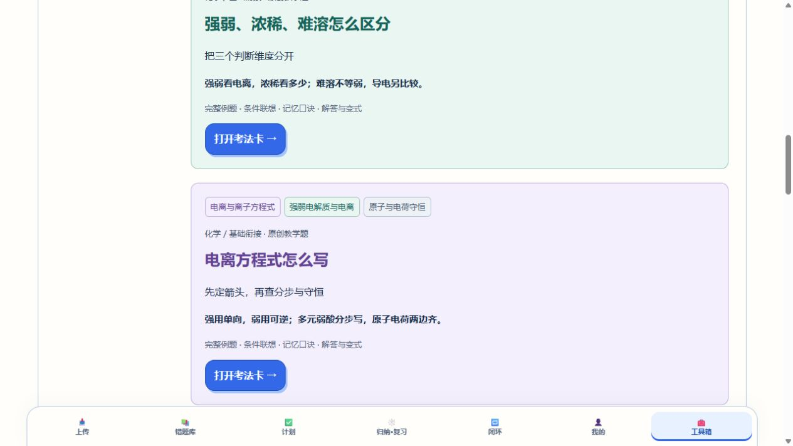

# 喵会错题

面向高中学习场景的错题整理与复习项目。通过拍照、相册、文字或浏览器语音输入题目，核对识别结果后入库，再围绕自己的卡点进行 AI 陪练、变式练习、知识卡整理和间隔复习。

项目希望保留学生“当时怎么想、卡在哪一步、后来能不能独立做出来”的过程，让一道错题能够继续用于训练，而不只是保存一张照片。

当前以网页版为主要使用入口，另有移动端适配与原生桥接代码。本文以当前网页实现为准，不把移动端专属能力写成所有浏览器都支持的功能。

## 从哪里开始

- 第一次使用：[完整使用手册](docs/使用手册.md)。
- 第一次把项目上传到 GitHub：[新手发布指南](docs/GitHub发布指南.md)。
- 一次性查看项目介绍、使用手册与发布指南：[完整文本合集](docs/项目介绍与发布操作合集.txt)。
- 准备填写 API：[配置示例](server/.env.example)，真实密钥只填在自己的运行环境中。

## 学习流程

```text
注册或登录学生账号
        ↓
确认学习服务在线并配置 AI
        ↓
拍照 / 相册 / 文字 / 语音 / 批量错题 / 试卷和答题卡
        ↓
核对题干、科目、知识点、错因与自己的做题过程
        ↓
确认入库 → 查看原题和解析 → 需要时查看几何模型
        ↓
AI 围绕卡点继续提问 → 自己作答 → 核对与修正
        ↓
变式与迁移练习 → 用自己的话整理知识卡
        ↓
按计划完成回忆作答 → 评分 → 安排下一次复习
```

## 已有功能

### 学生账号和学习资料

支持账号名称或兼容邮箱形式的账号与密码登录，支持首次注册、姓名、班级、选科资料编辑、退出当前设备和退出所有设备。新注册账号按页面要求填写至少 6 位的账号名，密码至少 6 个字符；正式使用建议设置更长且不重复使用的密码。

学校多人模式需要启用服务端鉴权，个人错题、陪练和学习进度按账号访问。本地开发模式不能当作已完成多用户隔离的公网环境使用。

### 多种录题入口

- 单题拍照：打开摄像头或从相册选图，压缩后交给学习服务识别。
- 文字录入：输入题目、条件和自己卡住的地方。
- 语音录入：在支持浏览器语音识别的设备上，将语音转成可编辑文字；提交前仍需核对。
- 批量错题：分批上传错题页，预检照片清晰度、题目拆分和做题过程，再逐题确认。
- 试卷与答题卡：同时上传试卷页与答题卡，按题号匹配、参考批改与得分信息进行核对。
- 题目附件图：补充电场图、坐标图等；批量核对页还可从原试卷页裁出单题题图。

### 核对和错题管理

识别结果进入核对步骤，学生可修改题干、科目、知识点、错因和相关证据。无法确认的内容会交回学生核对；读不到的手写过程不会自动等同于已经知道学生哪里不会。

错题库支持按条件查找、打开题目详情、编辑、删除，以及查看原题图片、解析和做题记录。特定几何题可在后台生成或重试模型；是否有模型取决于题目条件与当前支持范围。

### AI 陪练和迁移练习

AI 陪练保留多轮对话，根据学生表达继续追问，引导学生解释条件、选择方法和完成推理。闭环页把诊断回顾、分阶变式与知识卡整理串在一起。AI 输出和自动判定都需要结合原题核对，不作为官方答案或考试评分。

### 知识卡和间隔复习

可选择原题、知识点、错误答案、正确答案、AI 引导或自己的理解，编辑知识卡的正面与背面。计划页提供知识卡闯关、按学科选择薄弱知识点、调整数量和顺序。完成真实回忆与评分后，由 FSRS 相关模块安排后续复习。

### 归纳和学习进度

按学科、知识点与错因观察自己的薄弱点；可在列表、知识关系与统计视图中查找相关错题。图表反映当前已有记录，不代表完整测量了学生的知识水平，也不承诺提分。

### 学习资源与共享

可整理教辅、页码、题号和课程链接。共享知识库支持浏览、搜索、收藏或导入；具备相应权限的用户可预览并确认公开自己的资料、错题整理或知识卡合集。分享前应去掉身份信息、私人作答和无权公开的教材内容。

### 教材考法库

数学、化学的方法卡包含题目、条件联想、分步解答、易错点与迁移辨析。目录支持学科、大类、细分知识点与关键词组合筛选；彩色题目面板使用固定的知识分类标签。

数学覆盖当前已整理的立体几何、直线与圆、圆锥曲线方法；化学覆盖电解质、电离、酸碱对应、水解与反应迁移等内容。目录中待建设的知识点不等于已有完整讲解；教材页的临时自检不自动写入个人学习记录。





### 几何和电场可视化

支持部分空间几何题的结构化建模、模型交互，以及圆柱、圆锥、球的相关学习入口。电场实验台支持点电荷叠加、匀强电场和若干理想模型，联动观察电势、场强与粒子运动。具体条件、精确解或趋势示意以页面提示为准。

本介绍不展开工具箱中几何与学科工具、电场实验台等独立工具的使用方法。

## 本地运行

### 环境

- Node.js：当前项目在 Node.js 24 环境中验证；先安装对应环境。
- Python：几何求解和 FSRS 桥接等功能需要可用的 Python 3.11 或以上解释器。
- 支持 JavaScript 的浏览器；涉及 3D 时还需要 WebGL。
- AI 功能需要有效 API 配置和可访问的模型服务。只打开网页不代表 AI 已经连通。

### 启动

下载仓库 ZIP 并解压，或克隆仓库。在项目根目录打开 PowerShell：

```powershell
cd server
npm.cmd ci
Copy-Item -LiteralPath '.env.example' -Destination '.env'
notepad .env
```

在 `.env` 中填写自己的 API Key，按需要设置 Python 路径，保存后启动：

```powershell
npm.cmd run start:model
```

打开终端实际打印的地址，默认是 [本机网页](http://127.0.0.1:4180/)。保留运行服务的终端；按 `Ctrl+C` 会停止服务。已有 `.env` 时不要重复复制覆盖。

当前提供的示例配置只监听本机，启用账号鉴权；该模式下模型由运行服务的人配置。若你保留项目原有的本地单用户模式，也可以在「我的 → AI 服务」填写服务端密钥。两种模式的具体区别见使用手册。

## 技术结构

```text
implementation/        网页、交互模块、样式和静态资源
server/server.mjs      HTTP 服务、静态资源和业务入口
server/workflows/      录题、账号、陪练、复习、几何和共享等模块
server/python/         Python 桥接和求解代码及随附依赖
server/third_party/    第三方技能快照与许可
server/test/           自动化测试
docs/                  使用和发布文档
```

前端以 HTML、CSS、JavaScript 为主，服务端使用 Node.js，当前数据持久化以 JSON 文件为主。数据文件和上传目录属于运行状态，不应随源代码发布。

## 使用边界

- 识题、解题、判题和知识点建议可能出错，保存前核对原题。
- 语音受设备、浏览器、权限和网络条件影响；相册或文字录入是替代方式。
- 几何模型只覆盖实现和验证过的题型，无法把任意数学题都转换成可靠的 3D 场景。
- 本机地址只能在运行服务的电脑上使用；GitHub 仓库和 GitHub Pages 都不能代替本项目的 Node/Python 后端。
- 公网使用需单独配置 HTTPS、账号鉴权、访问权限和数据备份；本地能运行不等于已完成生产部署。
- 当前存在尚未完成的内容和历史测试问题，不宣称全量测试全部通过。

## 隐私和密钥

不要上传 `.env`、模型本地配置、真实 `data.json`、原始试卷照片、账号会话、备份或调试日志。使用 AI 时，相关题目或图片会按所启用的功能发送给配置的模型服务；浏览器语音识别还可能使用浏览器提供方的服务。

网页端的服务端 Key、学校统一配置的 Key 与 APK 原生安全存储不是同一种存储方式。不要用“所有密钥都只存在浏览器本地”来描述本项目。

## 来源和许可

本项目包含第三方代码与教材相关内容，不能用一个许可证覆盖所有内容。第三方组件继续适用各自许可证；参考代码、NOTICE、教材题目和图示应保留对应来源。

EduLab 快照的许可见 `server/third_party/edulab/LICENSE` 与 `NOTICE`；Three.js、KaTeX、Python 随附组件等依各自许可。教材、真题、插图的来源说明不等于再分发授权，发布前仍须确认权利。

自有代码的对外许可证仍需维护者在正式发布前确认并添加。

## 反馈问题

提交 Issue 时，请描述所在页面、操作步骤、期望结果和实际结果，并提供去掉姓名、学校、API Key 与私人题目的截图。请不要在公开 Issue 中粘贴运行配置或完整学生数据库。
