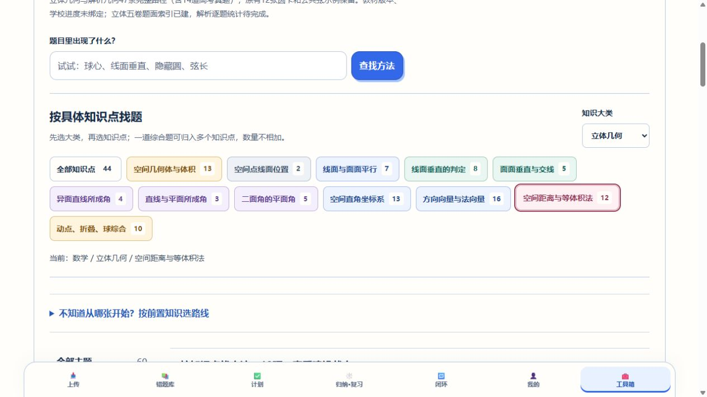
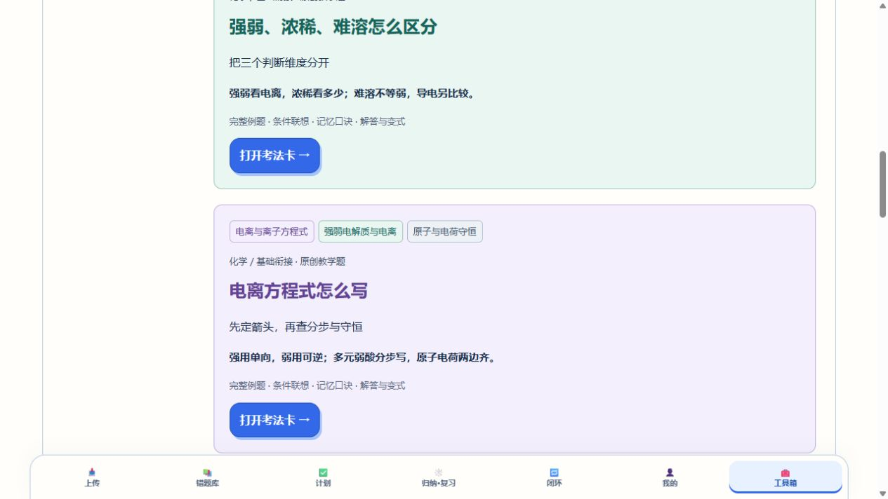

# 喵会错题完整使用手册

本文面向第一次使用项目的学生、老师和本地运行者，按照“打开服务 → 登录 → 接 API → 录题 → 陪练 → 整理知识卡 → 复习 → 分享”的顺序说明。内容依据 2026 年 11 月 5 日当前网页和代码整理；不同部署版本的按钮和可用范围可能略有不同。

教材考法库中的数学、化学仍在本手册范围内；工具箱中几何与学科工具只保留物理电场。文中讲到“支持”，表示当前有对应实现，不代表已实测所有设备、所有模型或全部题型。

## 一 先分清三个不同账号

| 名称 | 用来做什么 | 在哪里使用 |
|---|---|---|
| 喵会错题学生账号 | 保存和访问自己的学习记录 | 网站的登录与个人页 |
| DeepSeek 等模型平台账号 | 创建模型 API Key、查看模型用量 | 模型提供方官网 |
| GitHub 账号 | 保存代码、查看版本和处理 Issue | GitHub 网站或客户端 |

这三个账号互不替代。能登录 GitHub，不代表已经有模型额度；能打开 DeepSeek 聊天网页，也不代表这个学习网站已经配好 API。

## 二 打开项目

### 已有人部署网站

使用维护者给出的完整网址。在同一个部署的网站注册并登录；如果换成另一个部署地址，原来的数据不会自动跟随。第一次可先浏览工具箱中的只读教材考法，确认页面能够加载。

### 自己在电脑上运行

1. 安装 Node.js 和项目所需 Python；README 的本地运行部分列出了环境。
2. 在项目根目录打开 PowerShell，再进入 `server`。
3. 首次运行执行 `npm.cmd ci`。
4. 将安全示例 `.env.example` 复制为 `.env`，只在自己的 `.env` 中配置参数。
5. 执行 `npm.cmd run start:model`，保留终端窗口。
6. 打开终端打印的地址，通常是 `http://127.0.0.1:4180/`。

`127.0.0.1` 表示当前设备本身。电脑上的这个地址不能直接作为手机访问电脑的地址；手机上的同一地址指向手机。不要把本机地址放进 GitHub README 当成公众演示网址。

## 三 注册与登录

### 第一次注册

在首页点击「登录 / 注册」，或点击底部「我的」。按页面填写账号名称、姓名、班级和密码，点击「首次注册」。账号名建议使用至少 6 位、容易记住的姓名拼音或字母数字组合，例如 `xiaolin2026`；不要把示例当成公共默认账号。账号名支持的字符和长度以页面校验为准。

密码至少 6 个字符，建议使用更长且不与其他网站重复的密码。资料中的姓名、班级用于自己的学习档案；公开演示时使用虚构资料。当前入口不应被描述为已接入短信验证码、微信登录或完整邮件验证。

注册成功后，网站建立相应学生档案；不是让所有人共用一个账号。若提示账号被占用，使用原密码登录，或更换账号名。

### 已有账号

输入账号和密码后点「登录」。注册表单中的姓名、班级不是账号名称的替代物。忘记密码时，当前版本应联系维护者确认恢复方式，不要假设已经有可用的邮件找回流程。

### 个人资料与退出

登录后在「我的」编辑姓名、班级和选科，点「保存资料」。页面提供「退出登录」与「退出所有设备」。会话配置约 30 天有效，并限制同时保留的设备会话数量；共用平板用完应主动退出，不要只关闭网页。

正式多人使用必须启用服务端 `AUTH_REQUIRED=1`。原有 `AUTH_REQUIRED=0` 的本地演示环境不能被当成严格隔离的学校部署。账号和数据隔离由服务端配置决定，不是单靠页面上出现登录框。

## 四 接入 AI API

### 先取得自己的 Key

打开 [DeepSeek 官方 API 文档](https://api-docs.deepseek.com/zh-cn/)，从文档中的「申请 API key」进入官方平台，登录后创建自己的 Key。检查平台是否有可用额度以及当前模型权限。项目示例配置使用 `deepseek-flash`；模型名称和接口能力可能随提供方更新，若调用失败请以官方文档及账号控制台为准。API 可能产生费用，以提供方当时的规则为准；本手册不承诺免费。

复制 Key 后只填写在自己的运行配置或明确的密钥输入框，不粘贴到 GitHub、聊天截图、题目正文或公开 Issue。Key 泄露时应先在模型平台撤销或轮换，不能只删除公开页面上的文字。

### 方式 A 网页中的本地单用户配置

该入口适用于服务运行在本机、且服务端没有启用学校统一配置限制的情况：

1. 登录自己的学生账号。
2. 点击底部「我的」。
3. 在「AI 服务」查看“已配置”或“未配置”的状态。
4. 在「DeepSeek API Key」输入框粘贴 Key。
5. 点击「保存并切换」，等待成功提示，再点「刷新状态」。

此处保存的是这台学习服务器使用的 Key，不是账号资料中的一个普通字段。当前实现把配置写到本地模型配置文件；不要把文件当成已加密保险箱，也不要随项目打包上传。

“已配置”首先说明服务读到了配置，不等于每种模型能力都调用成功。可用一段不含隐私的短文字题进行功能检查；先核对成功提示，再确认后续 AI 回复是否返回。配置成功后不用为每个按钮重复填写 Key。

### 方式 B 在服务端 `.env` 配置

启用 `AUTH_REQUIRED=1` 后，学生个人页会提示由管理员统一配置。维护者在 `server/.env` 设置：

```dotenv
HOST=127.0.0.1
PORT=4180
PORT_PROBE_LIMIT=1
AUTH_REQUIRED=1
CORS_ORIGIN=http://127.0.0.1:4180
DEEPSEEK_API_KEY=
DEEPSEEK_MODEL=deepseek-flash
```

示例中的中文占位文字不是有效密钥。修改 `.env` 后，停止自己正在运行的服务，再用 `npm.cmd run start:model` 重新启动，环境变量才会被重新读取。不要重复启动多个实例，也不要改为关闭鉴权来解决配置权限问题。

项目还可能保留更细的视觉模型或供应商适配参数。文字陪练可用，不代表图像识别一定可用；应确认当前实际启用的视觉链路和模型权限。不要随意往网页填另一个供应商的 Key，却以为本项目会自动切换所有请求格式。

### 方式 C Android 专属的本机密钥

代码包含 Android 原生桥接的 DeepSeek 配置入口，可在具备对应原生实现的 APK 中将 Key 保存到设备安全存储并测试连接。普通网页中没有这个原生桥接时，会显示环境说明。

不要把 APK 的本机存储说明套用于网页：网页方式 A/B 使用服务端配置。这里也不承诺所有移动端构建都包含相同功能；使用实际发布的构建和版本说明。

### 常见配置问题

| 表现 | 先检查什么 |
|---|---|
| 学习服务无法连接 | 终端是否仍在运行、地址和端口是否正确 |
| Key 格式错误 | 是否漏字符、夹带空格、粘贴了平台密码或占位文字 |
| 401 或认证失败 | Key 是否有效、是否属于当前配置的供应商 |
| 额度不足或 402 | 到官方控制台检查额度和计费状态 |
| 文字可用但图片失败 | 当前图像识别链路、模型图像权限与图片质量 |
| 超时 | 网络、服务状态和输入长度；先用单题或更少页重试 |
| 学生不能保存服务器 Key | 可能是学校统一配置模式，应联系维护者 |

## 五 录入一道题

### 拍照或从相册选择

首页点「拍照录入」。纸张摆平，题干、图形和需要分析的做题过程尽量拍全，避免反光。点「打开摄像头」或「从相册选择」，允许与此操作相关的相机权限或选择已有照片。

页面会压缩图片，再发送给学习服务处理。压缩有助于传输，但识别仍依赖图片清晰度。不要因为界面出现了识别文本，就跳过原题核对。

### 键盘与语音

点「文字/语音录入」，输入完整题干和自己的卡点。语音输入点击「开始语音输入」，在支持的浏览器中按提示授权麦克风。识别出的文字可以编辑，再点击「识别并核对」。

读数学题时，应明确说出上下标、分数、括号和点名，识别后检查 `A`、`A′`、`a`、平方与负号。语音识别不是无条件离线功能；不支持、权限被拒绝或网络异常时，改用键盘或图片，不要反复提交错误转写。

### 补充题图

题干文字之外需要坐标图、电场图或示意图时，使用「添加/截取题图」。上传后检查附件预览是否为当前题对应的图片。只输入文字而没有给图中的必要条件，不能期待系统凭空还原原图。

## 六 核对并入库

检查以下内容后再确认：

1. 题干是否完整，符号、单位、选项和所求对象是否正确。
2. 科目与知识点是否合理，是否把多个题混在一起。
3. 学生原来的手写答案是否读对；没读到就不要补成一个想象中的答案。
4. 错因是否真的有题目或作答证据，不能把 AI 建议视为已确定事实。
5. 需要保留的原图、题目附件和相关设置是否已选好。

页面允许修改相关字段。对于支持的立体几何题，可选择生成 3D 模型；不是所有数学题都会生成模型。需要结合已有错点安排陪练时，可选择相应选项。

确认入库后，题目进入错题库，后续可打开陪练。保存题目、AI 完成解析、模型生成完成是不同状态；看到“正在后台生成”时可以先继续其他学习，再回到题目查看。

## 七 批量错题与整份试卷

### 批量错题

在上传页选择「批量错题」，按页选取图片。它适合错题页或作业，不要求额外答题卡。先做上传前预检，看看照片能否读清、一页中的题目是否正确拆分、做题过程是否能识别。

预检若建议重新拍摄，先处理模糊或遗漏；决定继续识别后，在核对页逐题检查、勾选。看不清的项会提示需要人工确认，不应无差别全部勾选。

### 试卷和答题卡

选择「试卷上传」，分别添加试卷与答题卡。该入口需要两者，不要把只有试卷题干的照片当成已经提交了学生答案。检查页序、题号、批改痕迹与得分；AI 应结合两部分核对，学生仍需要确认匹配关系。

### 多页分批与题图

当前实现每类一次最多选择 12 页。更多页应在同一草稿的追加流程中分批提交，并检查页号和题号；如果离开草稿重新开始，不要假设系统仍在合并同一份试卷。

核对页可修改科目、知识点和错因；对解答题中无法读清的过程，可按提示自己补写卡点或做题经过。选择题、填空题主要按可辨认的答案核对，不能因为题难就推断学生哪一步不会。

单题需要题图时，可以从对应原试卷页裁切，或从相册补充。确认勾选的题目后再入库，留意保存成功提示及后台建模状态。

## 八 使用错题库

点击底部「错题库」，用当前页面提供的搜索和筛选找到题目。打开详情后，查看题干、原图、学生作答、错因、知识点和解析。发现识别错误时先编辑题目，再继续练习，避免后续都建立在错误条件上。

需要空间模型的题可查看、旋转或缩放模型，并配合当前步骤显示的对象理解推理。模型不完整或失败时使用页面提供的重试入口；不支持的题型并不等于原题不能学习，也不应把失败模型当作正确的几何依据。

删除题目会影响相关学习记录，按页面确认操作。不要用删除正式题目测试界面；有疑问先备份自己的服务端数据。

## 九 进行 AI 陪练

从题目进入「陪练」相关入口，先看当前针对的卡点。用自己的话回答 AI 的下一问，例如“我知道它们垂直，但不知道该选面内哪两条线”。系统会根据表达继续给提示，而不是要求你只点“懂了”。

可以解释一小步、补充计算，或说明哪一句没看懂。对 AI 的结论有疑问时回到原题核对，特别注意辅助线是否为后来构造、某个长度是否真的是已知。

陪练记录与当前题目关联。刷新、切账号或换部署地址后的恢复能力取决于记录是否已经提交成功；输入框里刚打出的未提交文字不等于已经保存。

## 十 完成闭环与变式

底部「闭环」把练习分成诊断回顾、分阶变式与知识卡整理。先读原题、学生原话与诊断，再进入页面给出的近迁移、变式或综合迁移阶段。

先独立作答，再提交判断或请求提示。题目换了条件，不要只把原答案里的数字替换掉；留意哪些方法仍成立、哪些前提已经失效。关卡显示的通过情况来自相应作答和判定，不代表已经在所有同类题上掌握。

完成后，把这次真正弄清楚的判断写下来，进入知识卡整理。没有题目或没有建立关联任务时，闭环页可能提示先选择题目，这是正常的前置条件。

## 十一 制作知识卡

在知识卡整理步骤，勾选准备放进正面的题目、知识点或 AI 引导问题；选择背面的答案、解析和自己的理解。不要把全部对话无差别塞成一张卡。

正面最好能让自己回忆一个具体方法，例如“求点到直线的距离时，怎样判断垂足在线段内？”背面写出关键条件、推理和最容易漏掉的一项。修改后点击保存，再到知识卡库确认内容。

保存后的知识卡可以进入复习。题面、自己的理解与 AI 补充是不同来源，整理时保留它们之间的区别；卡片背面不是无须检查的标准答案。

## 十二 使用计划页

底部「计划」提供知识卡大闯关和按学科安排的薄弱知识点。可以调整今日每科的数量、顺序，或自行挑选替换知识点。没有知识卡时，先完成一次陪练并保存理解，不要把空队列当作数据丢失。

开始闯关或所选复习后，先读提示、独立回忆，再翻面核对。按自己的真实表现提交评分；不确定与真正遗忘应如实记录，而不是为了进度全部选会了。

FSRS 相关模块会根据评分调整下次复习时间。页面显示的到期时间比自己估计“应该几天后复习”更适合作为本项目内的安排依据，但算法安排不代替考试和长期学习结果评估。

## 十三 查看归纳与复习

底部「归纳·复习」用于看自己的学科、薄弱点、错因与关联错题。先选择学科，再查看局部关系和具体题目，避免把跨科的概览图直接当成某一个知识点的诊断。

某些展示会综合错题、陪练、复习记录和学生自述；“自述卡点”与“作答证据”来源不同。掌握度、热力图或关系网络依赖已有数据，缺少记录不等于能力为零，也不代表图中没有的内容都已经会了。

## 十四 整理学习资源和共享资料

在「我的学习资源」录入教辅名称、页码、题号或课程链接，以便后续关联微技能。它不是对整本付费教材的自动抓取或再分发授权。

公共题型或共享知识库可以浏览和搜索。收藏、导入、发布或管理动作可能要求登录或相应权限。发布自己的错题整理或知识卡合集时，先预览实际公开的正文，再确认；不要公开学生姓名、私人聊天、真实账号或未经授权的图片。

共享资料导入个人库后，自己的练习与复习记录应独立保存。仅仅上传一个公开合集，不代表你的全部错题或学习进度都应该跟着公开。

## 十五 教材考法库

进入「工具箱 → 教材考法库」，选择数学或化学。使用「知识大类」缩小范围，再点击细分知识点，也可以同时搜索题面中的关键词。数学、化学筛选和题目色彩标签示例：`n`n`n`n

数学例如“立体几何 → 空间距离与等体积法”，或“直线与圆 → 弦长与弦中点”；化学例如“电离与酸碱对应 → 共轭酸碱与微粒电荷”。综合题可能有多个标签，分类计数不能相加成总题数。

彩色题目面板用于区分知识类别，文字标签负责说明实际含义；它不表示题目难度，也不表示你做对或做错。打开题目后，按完整题目、思考切入、分步解答、关键书写、易错点和迁移辨析阅读。

化学卡包含条件联想、记忆辅助和临时自检。数学卡可切换完整思路与关键书写。目录中的教材位置、原题条件和注明的补作示意要分别看；只读教材练习不会自动算作个人复习成绩。

## 十六 几何与电场工具

按本手册范围，这里只说明空间几何、圆体建模与物理电场。几何建模先检查对象、尺寸和所求，再观察模型；精确解、验证状态和不支持提示以当前题型实现为准。

电场工具可以选择点电荷叠加或匀强场等模型，改变电荷、半径、初速度等参数，观察电势、场强和运动曲线。先说出自己的预测，再动参数验证；数值若标为相对单位或趋势示意，就不要用来直接代入真实题目的单位数值。

复杂连续分布、边缘效应和真实装置可能超出范围。

## 十七 数据保存和恢复

已提交的题目、账号与学习记录由部署的服务保存；未提交的输入、临时页面自检和服务器记录不是一回事。退出账号通常不会删除服务器记录，但换服务地址、换数据文件或使用新部署会看到不同内容。

维护者备份时应包含数据文件和对应上传目录，必要时保留模型运行配置；它们应放在受保护位置，不放进 GitHub 仓库。恢复前先保留当前版本副本，并确认软件版本和数据路径匹配。

当前不能把 README 中没有实现或没有验收的“一键全量导出、一键云同步、任意模型兼容、所有题型精确求解”当成现成功能介绍。

## 十八 第一次完整体验的检查顺序

使用不含隐私的原创简单题，按以下步骤确认自己的部署：

1. 打开网页，确认服务状态正常。
2. 注册一个自己的测试账号并登录。
3. 确认当前部署的 AI 配置方式和模型状态。
4. 用文字录入一道题，核对后保存。
5. 在错题库找到刚保存的题，重新打开详情。
6. 进入陪练，提交一句真实回答，检查回复和记录。
7. 按页面可用流程完成一项变式或知识卡整理。
8. 在计划页找到知识卡，完成一次回忆与评分。
9. 回到个人页退出，再登录同一账号检查已提交记录。
10. 用相册图片检查识别；设备支持时再单独检查摄像头和语音。

这是建议运行的验收步骤，不是声明所有步骤都已在未来环境中通过。

